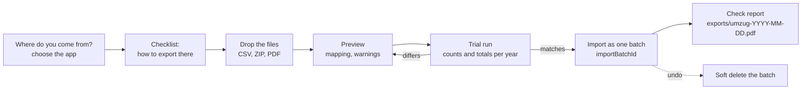

# Roadmap

kontor follows the feature set of epufix (Austria), adapted to German law: quotes → invoices → payments → income, expenses with receipts, a dashboard that answers "where do I stand?", a tax reserve, and exports for the tax advisor and the tax office. Everything runs locally from `file://`, with one folder per company (see [ADR 0001](adr/0001-local-first-file-storage.md) and [ADR 0002](adr/0002-one-folder-per-company.md)).

Calculators and exports are estimates and filling aids, not tax advice. Every year-dependent value comes from `src/domain/tax/params/<year>.ts`, with its legal source and tests.

The market analysis behind the feature list (competitors, what they export, sources) is in [competition.md](competition.md). Status: 21 October 2026.

## Scope

kontor is for sole proprietors with cash-basis accounting (EÜR, § 4 Abs. 3 EStG): freelancers (§ 18 EStG) and traders, each either as small business (§ 19 UStG) or with regular VAT and advance returns, as long as no double-entry bookkeeping is required (§ 141 AO, § 241a HGB). Out of scope: corporations (GmbH, UG) and partnerships (GbR, Partnerschaft).

One person with several businesses (for example a freelance activity and a trade) keeps one company folder per business: profit (EÜR) and trade tax are determined per business. For VAT the person is one single business (Unternehmenseinheit, § 2 Abs. 1 Satz 2 UStG): the small business limits apply to the total turnover, and there is one advance return. The setup assistant says so; adding up the turnover across companies is planned with the dashboard (Phase 4) and the UStVA filling aid (R1).

## Positioning

kontor cannot offer a live bank connection, direct ELSTER submission, AI receipt recognition or a native mobile app: the architecture rules them out (no server, no network, `file://`). For each of them there is an honest local alternative. kontor wins with no cloud, no subscription, an open and documented file format, offline use, open source, data in the user's own OneDrive or Nextcloud, one folder per company, and legally compliant e-invoices for everyone, small businesses included.

| Area | Competitors | kontor |
| --- | --- | --- |
| Bank connection | live via FinTS/PSD2 | import of CSV and CAMT.053 with bank presets and deterministic rules (F07) |
| ELSTER | direct submission | filling aid with a copy button per form field (R1); a local ERiC helper only as an option to evaluate (R7) |
| Receipts on the go | app with AI OCR | inbox folder in the cloud: scan with the OneDrive or Nextcloud app, kontor finds the file when it opens (F06). B2B receipts arrive as XML once the e-invoice obligation applies (2027/2028), so OCR is not needed for them |
| Email | sent from a server, with tracking | `.eml` draft with the PDF attached, opens as a draft in Outlook (`X-Unsent: 1`); fallback: download plus `mailto:` (F04) |
| Tax advisor | portal with login | share the folder and use the read-only mode (F13), or the package or the DATEV export (R4, R5) |
| Several users | roles, extra licences | shared folder with field-level merge (from teamtodo); numbering assumes one writer at a time (ADR 0004) |
| Price | about 8–20 € per month (to be verified, see competition.md) | free, open source |
| Data ownership | cloud, partial exports | files in your own storage, documented format, exit at any time (F12) |
| Mobile | native apps | capture through the inbox folder (F06). The File System Access API does not exist on smartphones, so there is no mobile app |

## Releases

**1.0 is reached when a typical freelancer or small business can switch to kontor completely, and moving from another app takes less than 30 minutes.** Everything marked Must below is part of it.

| Release | Content |
| --- | --- |
| **1.0** | Phases 1, 2, 3, 3.5 and 4 with all Must features (F01–F12, I1–I7), plus R1, R3, R4 and R5 |
| 1.x | Phase 5 (recurring income and expenses), Phase 6 (Excel export), F13–F17 |
| 2.x | Time tracking, F18–F20, R7 |

Priorities: **Must** = needed for 1.0, **Should** = 1.x, **Could** = 2.x, **Won't** = deliberately not. Effort: S, M, L.

### Won't

| Not planned | Why |
| --- | --- |
| Live bank connection (FinTS/PSD2) | needs network access and bank credentials, contradicts ADR 0001; bank statements are imported instead (F07) |
| Double-entry bookkeeping, balance sheet, payroll | the target group uses the EÜR (see Scope) |
| Stock and inventory | not needed by the target group |
| Native mobile app | the File System Access API is not available on smartphones; the inbox folder covers capture on the go (F06) |
| AI categorisation | needs a model or a service; deterministic rules instead (F07) |

## Phases

### Phase 0: foundation (done, 0.1.0)

Tooling, `file://` build with CSP, data layer (repository, validation, migrations, merge, persister, daily backup), money and IBAN basics, setup assistant, several companies with switcher, settings, German and English.

### Phase 1: customers, bank accounts, quotes, invoices

- **Customer management (done):** customers and suppliers in `contacts/<id>.json`: company or private person, name and additional name line, address, contact person, email for invoices, phone, customer number, VAT ID (EU business customers), Leitweg-ID for public authorities (buyer reference, BT-10), a default order or PO number (purchase order reference, BT-13; can be changed on every document), payment term and notes per customer.
- **Bank accounts (done):** several accounts per company (for example two current accounts and PayPal), one of them the default for invoices; the invoice shows the account chosen for it. The single bank account of `company.json` became a list in schema version 2.
- Quotes with "valid until" (drafts with lines and totals done; number, PDF and the step to an invoice open); a quote becomes an invoice with one click.
- Invoices with the mandatory content of § 14 Abs. 4 UStG; small amount invoices (§ 33 UStDV, up to 250 € gross).
- Small business: no VAT column, note on § 19 UStG. Regular: 19 %, 7 %, 0 %; reverse charge § 13b UStG ("Steuerschuldnerschaft des Leistungsempfängers"); intra-community supplies with the VAT IDs of both parties.
- Date or period of service.
- PDF with logo, bank details and optional GiroCode (EPC QR).
- Finalization: issuing assigns the number, writes `documents/issued/<number>.pdf` and its SHA-256, and an audit entry. Corrections only through cancellation or correction invoices ([ADR 0004](adr/0004-invoice-finalization-and-numbering.md)).
- Payments, including partial payments, each booked to one of the bank accounts; open and overdue invoices.
- **Customer accounts:** per customer the invoices, payments, credit notes and the open balance.

Must features added from the market analysis:

| ID | Feature | Content | Effort |
| --- | --- | --- | --- |
| F01 | **Catalogue of items and services** (catalogue done) | number, name, description, unit, net price, VAT rate. Insert lines by search; the price can be changed per document (comes with the document editor) | M |
| F02 | **More document types** | correction invoice / credit note, cancellation, order confirmation. **Down-payment and final invoices** that deduct the down payments and their tax (important for trades and crafts); may become a Phase 1b | L |
| F03 | **Dunning levels** | payment reminder and dunning levels 1–3, dunning fee, default interest under § 288 BGB (consumers: base rate + 5 points; businesses: base rate + 9 points and the 40 € lump sum). The base rate (§ 247 BGB) changes every half year, so it lives in `tax/params` with a validity date | M |
| F04 | **Prepare sending** | text templates with placeholders (`{Rechnungsnummer}`, `{Fälligkeit}`, …), an `.eml` file with the attachment, fallback `mailto:`. The sending date goes into the audit log. A `mailto:` link built by the app needs a documented exception to the rule that only `http:` and `https:` become an `href` | S |
| F05 | **Layouts and language** | 2–3 invoice layouts, accent colour, footer in columns. **Invoices in English** (language per customer) | M |
| I3 | **Import contacts from CSV** | see Phase 3.5; possible as early as Phase 1, because contacts exist already | M |

### Phase 2: e-invoices

- **Outgoing:** ZUGFeRD / Factur-X (profile EN 16931 or XRECHNUNG, PDF/A-3 with embedded XML) and plain XRechnung XML (CII; UBL optional). Optional for small businesses; mandatory for regular businesses after the transition periods (2027 with a previous-year turnover above 800,000 €, otherwise 2028).
- **Incoming** (every business must be able to receive e-invoices since 2025, small businesses included): drop an XRechnung XML or a ZUGFeRD PDF → readable view → expense with prefilled fields.
- Every business can issue legally compliant e-invoices, also where the law does not require it yet. Fixtures for every supported case (regular VAT, small business, reverse charge, intra-community supply, credit note, cancellation) are validated in CI with the KoSIT validator, veraPDF and a ZUGFeRD validator (Java, GitHub Action), not in the browser. A format is offered only once its fixtures pass.
- The reader for incoming e-invoices is also used to import an invoice archive (I4).
- Library decision: [ADR 0005](adr/0005-e-invoice-library.md).

### Phase 3: expenses and receipts

- Expense: date, gross amount, VAT rate and input tax, category, supplier, payment method, note.
- Receipt as a file copied into the company folder (`belege/<year>/<id>-<name>`, with SHA-256) or as a link (`https://…` to SharePoint, Nextcloud or OneDrive; only http and https). With a link, keeping the receipt is up to its storage location; the UI says so.
- Categories map to an Anlage EÜR line and to SKR03/SKR04 accounts (for the DATEV export).
- CSV import of existing bookings with column mapping.
- **Bank statements:** import per bank account, match transactions with invoices (payments) and expenses, show what is not matched yet.

| ID | Feature | Content | Effort |
| --- | --- | --- | --- |
| F06 | **Inbox folder** `eingang/` | new files show up when kontor opens and when its window gets the focus (like the sync in teamtodo). E-invoices are recognised and prefilled. Assigning a file creates an expense, and the file moves to `belege/<year>/` | M |
| F07 | **Bank presets and rules** | CSV presets for Sparkasse, Volksbanken, DKB, ING, N26, Commerzbank/comdirect, Postbank and PayPal; CAMT.053. Rules such as "purpose contains X → category Y", deterministic, no AI | M |

### Phase 3.5: moving from another app (F10)

No other app offers a complete open export, but each one exports parts. Almost all of them export the **DATEV Buchungsstapel (EXTF CSV)**, because tax advisors need it. A good DATEV import therefore brings in the booking history from every app at once; contacts come as CSV, invoices as PDF or ZUGFeRD. Which app exports what is listed in [competition.md](competition.md#what-the-apps-export).

| Data | Common format | Import |
| --- | --- | --- |
| Bookings (income and expenses) | DATEV EXTF Buchungsstapel (CSV, Windows-1252, `;`) | I1 |
| Receipt images | DATEV receipt ZIP (`document.xml`) or ZIP with receipt ID | I2 |
| Contacts | CSV (columns differ per app) | I3 |
| Issued invoices | PDF; as e-invoice ZUGFeRD/XRechnung | I4 |
| Items | CSV | I7 |
| Bank transactions | bank CSV, CAMT.053, DATEV bank transactions | F07 |
| Own spreadsheet | CSV/XLSX | Phase 3 |

| ID | Feature | Content | Effort |
| --- | --- | --- | --- |
| I1 | **DATEV Buchungsstapel** | read the EXTF header (format category, version, financial year, period). The document date is `TTMM`, the year comes from the header. Columns: amount, debit/credit, account, contra account, BU key, Belegfeld 1, booking text, Beleglink. Whether a line is income or expense follows from revenue and expense accounts (**SKR03/SKR04**). Account → kontor category through the R5 table used backwards; unknown accounts are mapped once, and the mapping is kept per source | L |
| I2 | **Receipt images** | read the DATEV receipt ZIP (`document.xml`) and `receipts.zip`, link them to the bookings from I1 by GUID or receipt ID, copy them to `belege/<year>/` and store the SHA-256 | M |
| I3 | **Contacts CSV** | recognise the app by the column header, otherwise map by hand. Detect the encoding (UTF-8 with or without BOM, or Windows-1252, with `TextDecoder`), guess the separator, decimal comma. Duplicates by VAT ID, customer number, and name plus postal code. The old customer number is kept | M |
| I4 | **Invoice archive** | drop a folder of PDFs. ZUGFeRD/XRechnung is taken over fully structured (reader from Phase 2). A plain PDF becomes an "old invoice" with metadata from the document list (matched by invoice number) or entered by hand. Imported invoices have `origin: imported`, are read-only and have a hash. **No double counting:** the EÜR uses the bookings from I1; the invoice is only the linked document | L |
| I5 | **Continue the number range** | find the highest number per year from I4, suggest the next one, the user confirms. New numbers must not collide with imported ones (ADR 0004) | S |
| I6 | **Open items** | imported invoices without a matching payment are open, so dunning (F03) can pick them up | S |
| I7 | **Items CSV** | into the catalogue from F01 | S |

The **moving assistant** leads through the import:

- **A checklist per app** with the date it was last checked, because the apps change their screens.
- **The totals check is mandatory:** income and expenses per year are compared with the source. If they differ, nothing is imported.
- **Batch:** every imported record carries an `importBatchId`. A batch can be taken back as a whole (soft delete).
- **Check report:** the source files with their hashes, what was imported, totals and differences. It documents the move for the GoBD.

Before the work starts:

- **Real sample exports.** The column layouts of the apps are not documented publicly; without real exports the presets are guesses. Only a person with test accounts can get them:
  1. Define a reference dataset in `tests/fixtures/import/reference-dataset.md`: 8 contacts (private person, German company, EU company with VAT ID, public authority with Leitweg-ID), 12 invoices (19 %, 7 %, mixed, § 13b, intra-community supply, small business, credit note, cancellation, partial payment), 15 expenses with receipts, 3 items.
  2. Enter the same dataset in the trial versions, ordered by market weight: Lexware Office, sevDesk, Accountable, Papierkram, easybill, WISO MeinBüro, FastBill.
  3. Export everything that is offered, anonymise it and commit it with the export date.
  4. Update the matrix in competition.md: every "to be verified" becomes confirmed or not available.
  5. Repeat when an import test breaks or an app changes its format.
- **ADR 0006** (imports from other apps): channels (DATEV EXTF, CSV presets, invoice archive), batch import with `importBatchId` and rollback, the mandatory totals check, no double counting between bookings and imported invoices, continuing the number range.
- **ZIP library spike** (candidate: `fflate`, MIT, runs in the browser), under the CSP like ADR 0005. Phase 6 (XLSX) and R4 (package) use the same library.
- **Rules for importers**, to be added to CLAUDE.md with the first importer (I3 included):
  - Parsers are pure functions in `src/data/import/<format>/`: bytes or text in, `Result` out, no file access. App presets are declarative objects (column signature, column mapping, date format, decimal separator), not special code.
  - All input is untrusted: limits for file size and count; for ZIP files a limit for the unpacked size (against ZIP bombs), paths with `..` or absolute paths are refused, names are checked with `fileNames.ts`.
  - Amounts only through `money.ts` as `Cents`, never `parseFloat`.
  - Every importer has anonymised real fixtures in `tests/fixtures/import/<app>/<export date>/` and property tests for the CSV parser (quotes, line breaks inside fields, BOM, `;` and `,`).

### Phase 4: dashboard and tax reserve

- Profit of the current year, open receivables, small business limits (previous year 25,000 €, current year 100,000 €, from the tax parameters). The limits count the turnover of all companies of the same person that are known to this browser, because VAT treats them as one business (see Scope).
- Reserve per month: income tax, solidarity surcharge, church tax if any, trade tax and the VAT payable.
- Every number links to the bookings behind it.

| ID | Feature | Content | Effort |
| --- | --- | --- | --- |
| F08 | **Fixed assets and depreciation** | asset register, immediate write-off of low-value assets (GWG), straight-line depreciation (AfA), Anlage AVEÜR. Limits and rates from `tax/params`; also needed for R3 | L |
| F09 | **Special cases of the EÜR** | business meals (partly deductible), trips with the mileage allowance, home office allowance, gifts, private use of a car: as categories with rules from `tax/params`; also needed for R3 | M |
| F11 | **Search and reports** | global search; turnover per customer and month, open items, expenses per category, comparison with the previous year | M |
| F12 | **Exit at any time** | documented data format (`docs/data-format.md`), a ZIP of the whole folder, every list as CSV. A visible sign of trust | S |

### Phase 5: recurring income and expenses (1.x)

- **Retainers and subscriptions you sell:** a recurring invoice per customer with lines, interval (monthly, quarterly, yearly), start and optional end. The service period follows the interval.
- **Subscriptions you pay** (software, rent, insurance): a recurring expense with amount, VAT rate, category and supplier, prefilled each period. Each period still needs its own receipt; missing receipts are listed.
- kontor runs only while it is open, so nothing happens in the background: on opening, it lists what is due and creates drafts. Issuing a recurring invoice stays an explicit step, because it assigns the number and finalizes the invoice (ADR 0004).
- The dashboard and the prepayment forecast (R2) include the recurring amounts that are still to come in the year.

### Phase 6: Excel export (1.x)

- Every list (invoices, payments, customers and customer accounts, expenses, bank transactions) and the EÜR as `.xlsx`, with amounts as numbers and dates as dates, so they can be used for further calculations.
- The writer must run under the CSP of the build. It uses the ZIP library chosen in Phase 3.5, with own SpreadsheetML or a library chosen in a spike, like ADR 0005.
- CSV and XLSX exports (here and in F12) are protected against formula injection: a cell that starts with `=`, `+`, `-` or `@` is written as text.

### Should (1.x)

| ID | Feature | Content |
| --- | --- | --- |
| F13 | **Read-only mode for the tax advisor** | open a folder without write permission; no editing, exports still work |
| F14 | **Cash book** | cash income and expenses in a running sequence, corrections only by a counter entry, cash report. Strict GoBD rules; needs its own ADR |
| F15 | **Foreign currencies** | currency per document and receipt, exchange rate entered by hand (no network), conversion for the EÜR |
| F16 | **Projects and cost centres** | a tag per booking and document, reports per project. The basis for time tracking |
| F17 | **Time tracking earlier** | time tracking is a reason to switch at Papierkram and sevDesk. **Open decision:** move it from 2.x to 1.x |

### Could (2.x)

| ID | Feature | Content |
| --- | --- | --- |
| F18 | **Local OCR (spike)** | for example tesseract.js (WASM). It needs `wasm-unsafe-eval` in the CSP, which changes a project rule and needs an ADR |
| F19 | **Import of shop orders** | orders from an Etsy or Shopify CSV become a series of invoices |
| F20 | **Batch invoices** | issue one template to many customers at once (unlike the recurring invoices of Phase 5, which repeat for one customer) |
| R7 | **ELSTER helper** | as planned: evaluate only |

### Time tracking (2.x, see F17)

- Projects per customer, time entries (manual and with a timer), hourly rates per project or customer, billable or not.
- Billable time becomes invoice lines (hours as quantity in thousandths, see ADR 0003); a time entry is billed only once.
- Reports per project and customer.

### Tools without a company folder

They run without setup and store nothing, which makes them a good entry point on GitHub Pages:

1. Invoice template for small businesses → PDF
2. Quote template → PDF
3. Tax calculator for the self-employed (income tax, solidarity surcharge, church tax, trade tax, rough health and care insurance estimate) → reserve per month
4. EÜR template as `.xlsx` or CSV with the Anlage EÜR lines and a short guide

## Exports for the tax office

Sending returns to ELSTER directly needs the native ERiC library and a registration as software vendor. A serverless `file://` app cannot do that. kontor therefore prepares the values for filling in and exports files, instead of sending.

| Stage | Content | Benefit |
| --- | --- | --- |
| R1 | **UStVA filling aid** per period, one return for all companies of the same person (see Scope): tax bases and tax by form field (for example 81, 86, 66, 83; § 13b, intra-community), cash or accrual accounting, due date (10th of the following month, one month later with permanent extension). A view for typing into "Mein ELSTER" with a copy button per form field, plus PDF and CSV. Field numbers come from `tax/params/<year>.ts`, checked against the current form. | Regular businesses do the advance return in minutes |
| R2 | **Income tax prepayments:** forecast of the annual profit → estimated income tax, solidarity surcharge, church tax and trade tax versus the assessed prepayments (10 March, 10 June, 10 September, 10 December). A hint when an adjustment request might make sense. | No surprise back payment |
| R3 | **Anlage EÜR:** totals per line, year-end view, PDF and CSV. Uses F08 and F09. | Fill in without a tax advisor |
| R4 | **Package for the tax advisor:** ZIP with the booking list (CSV), all receipts or receipt links, issued invoices (PDF/XML), account mapping. | Replaces the shoebox |
| R5 | **DATEV export** (Buchungsstapel EXTF CSV, SKR03/SKR04) and receipt images. The DATEV import (I1) uses the same account mapping backwards. | Can be read into DATEV directly |
| R6 | **GoBD package:** template for the process documentation (Verfahrensdokumentation), finalization check report (hashes versus files), data export for a tax audit. | Ready for an audit |
| R7 (open) | Sending to ELSTER through a separate local helper with ERiC. To be evaluated, not built. | Convenience |
